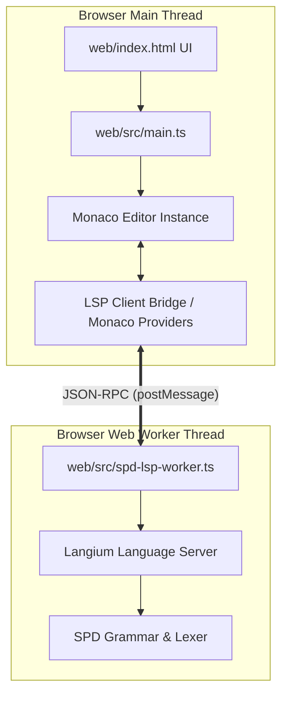

# 実装計画: WebアプリのMonaco Editor化およびLangium LSP連携

## 1. 概要
本計画は、現在 `web/index.html` 上で単純な `<textarea>` として実装されているエディタを、機能豊富で構文支援が利用可能な **Monaco Editor** に置き換え、さらに Langium で定義された SPD 言語の **LSP（Language Server Protocol）サーバーを Web Worker 内で稼働させ、Monaco Editor と連携させる** ことを目的とする。

---

## 2. アーキテクチャ設計



### 2.1 主な構成要素
1. **Langium LSP Web Worker (`web/src/spd-lsp-worker.ts`)**:
   - `vscode-languageserver/browser` の `BrowserMessageReader` / `BrowserMessageWriter` を使用して `self` との通信を確立。
   - `src/spd/langium/spd-module.ts` で Langium の LSP 用サービス（`createDefaultSharedModule`, `createDefaultModule`）を注入。
   - `startLanguageServer(shared)` を呼び出し、ブラウザ内の独立スレッドで LSP リクエスト/通知（`textDocument/didOpen`, `didChange`, `completion`, `publishDiagnostics` 等）を処理。

2. **LSP Client Bridge / Monaco 連携 (`web/src/lsp-client.ts`)**:
   - Monaco Editor のモデルイベント（`onDidChangeContent` など）を監視し、Worker に LSP 通知を送信。
   - Worker からの `textDocument/publishDiagnostics` を受信し、`monaco.editor.setModelMarkers` で波線とエラーメッセージを表示。
   - Monaco の `languages.registerCompletionItemProvider` に接続し、Worker へ `textDocument/completion` を問い合わせてコマンド補完（`:if`, `:while`, `:call` など）を提供。
   - シンタックスハイライト用に Monaco Monarch トークナイザー（または Semantic Tokens）を定義し、`:command` やコメント `#` などを色分け表示。

3. **Monaco Editor UI 統合 (`web/index.html`, `web/index_styles.css`, `web/src/main.ts`)**:
   - `<textarea id="spdInput">` を `<div id="spdEditorContainer"></div>` に置換。
   - 既存の機能（リアルタイムSVGプレビュー、共有URLのデコードと初期化、ファイルアップロード/ダウンロード、AST/SPD切り替えなど）を Monaco Editor の API（`getValue()`, `setValue()`, `onDidChangeModelContent`）に合わせて透過的に動作するように改修。
   - Monaco のリサイズ対応（`automaticLayout: true`）やフォント・スタイリングの調和。

---

## 3. 実装ステップ

### ステップ 1: パッケージおよびモジュール解決の整備
- `package.json` の alias に `vscode-languageserver` のブラウザ版パスを追加。
  ```json
  "vscode-languageserver/browser": "vscode-languageserver/lib/browser/main.js",
  "vscode-languageserver": "vscode-languageserver/lib/browser/main.js"
  ```
- `monaco-editor` のインストールと動作確認。

### ステップ 2: Langium LSP サービスと Web Worker の実装
- `src/spd/langium/spd-module.ts` に LSP 用モジュール作成関数 `createSpdServices(context)` を整備。
- `web/src/spd-lsp-worker.ts` を作成し、LSP サーバー起動コードを記述。

### ステップ 3: Monaco Editor と SPD 言語登録
- SPD 言語の Monaco トークナイザー（Monarch）を定義（コマンド `:if`, `:while`, `:call`, `:switch`, `:case`, `:else`, `:terminal`, `:comment`、コメント `#...`、文字列・引数等）。
- Monaco の言語設定（コメント構文、インデント設定、オートクローズ等）を登録。
- Monaco Environment のワーカーローダー（`editor.worker`）を設定。

### ステップ 4: LSP 通信ブリッジの実装
- Web Worker を起動し、Monaco のドキュメント URI（例: `inmemory://model/input.spd`）と同期。
- `textDocument/didOpen`, `textDocument/didChange` の送信。
- `textDocument/publishDiagnostics` を受信して Monaco のマーカーを更新。
- `monaco.languages.registerCompletionItemProvider` で LSP の補完候補を Monaco 形式にマッピングして返却。

### ステップ 5: メインUI（`main.ts`, `index.html`, `index_styles.css`）の統合
- HTML の textarea を Monaco Editor コンテナへ置き換え。
- CSS でエディタの高さ・境界線・角丸・レスポンシブ配置を調整。
- `main.ts` で Monaco インスタンスを初期化し、既存のすべての機能（SVG描画、共有URL処理、エクスポート、ファイル読み込み等）との接続を更新。

---

## 4. テストと検証方針

1. **構文チェック & 診断 (Diagnostics)**:
   - エディタに不正な構文（例: 未知のコマンド、インデント不整合など）を入力した際、Monaco Editor 内で該当箇所に赤波線が表示され、ホバーでエラーが表示されること。
2. **コード補完 (Completion)**:
   - `:` を入力した際、SPD のコマンドリスト（`:if`, `:while`, `:call` 等）が補完候補として表示されること。
3. **ハイライト (Syntax Highlighting)**:
   - コマンド、コメント、プロセス本文が適切にハイライトされること。
4. **既存機能の互換性**:
   - テキスト入力時にリアルタイムで右側の SVG / AST が再描画されること。
   - ファイルのアップロード / ダウンロードが正しく動作すること。
   - 共有リンクの生成・読み込みが正しく動作すること。
5. **テストスイート**:
   - `npm test`（ユニットテスト）がすべてパスすること。
   - `npm run build:web`（Webビルド）がエラーなく完了すること。
